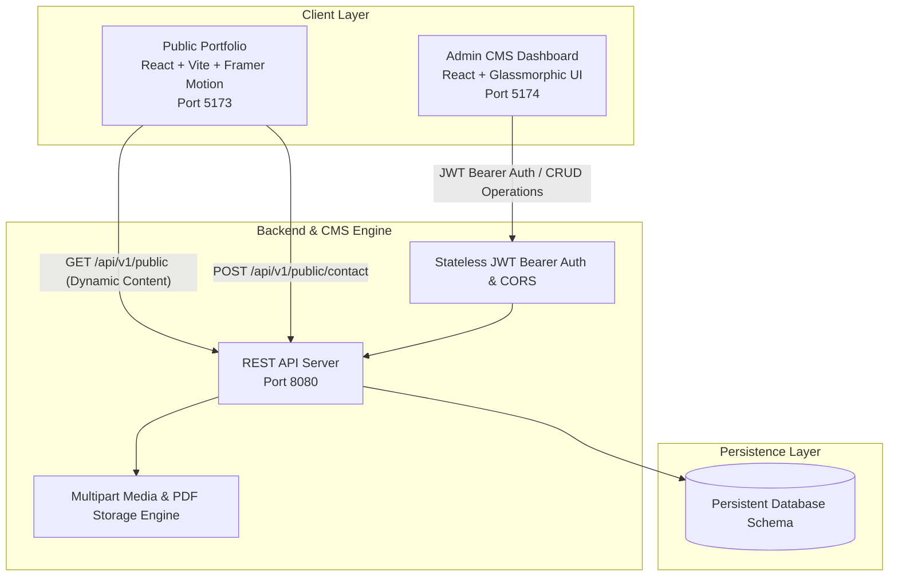

# 🎙️ 10-Minute Project Presentation & Live Demo Script

**Project Title:** Dynamic Full-Stack Portfolio & Headless CMS Control Center  
**Presenter:** Piyush Funde  
**Tech Stack:** React (Vite, Framer Motion), REST API, JWT Authentication, Multipart File Storage, MySQL / Persistent DB  

---

## ⏱️ **TIMELINE OVERVIEW**

| Section | Duration | Focus Area |
| :--- | :--- | :--- |
| **1. Introduction** | 0:00 – 1:30 | Problem Statement, Motivation & Project Overview |
| **2. Architecture** | 1:30 – 3:30 | 3-Tier Decoupled Architecture, Data Flow, Security |
| **3. Code Walkthrough**| 3:30 – 5:30 | Key Files, Dynamic Fallback Cache, Timeline & PDF Loader |
| **4. Live Demonstration** | 5:30 – 8:30 | Real-time CMS Edits, Resume Upload, Dynamic Sync, Messages Inbox |
| **5. Conclusion & Q&A** | 8:30 – 10:00 | Engineering Highlights, Scalability & Viva Questions |

---

## ⏱️ **Minute 0:00 – 1:30 | Introduction & Problem Statement**

> 🖥️ **Screen Display:** Public Portfolio Homepage (`http://localhost:5173`)

### 🗣️ **Spoken Script:**
> *"Good morning / afternoon everyone. Today, I am presenting my **Full-Stack Dynamic Portfolio & Custom Headless CMS Architecture**.*
>
> *Traditional personal portfolios are static — whenever you finish a new project, complete an internship, or earn a certificate, you have to manually edit the source code, rebuild the application, and trigger a new deployment cycle.*
>
> *To solve this, I designed and engineered a **decoupled, real-time Headless CMS architecture** that allows me to manage my entire professional portfolio — including projects, work experience, resume PDFs, technical skills, blogs, and contact messages — dynamically through an authenticated admin panel without writing a single line of code or redeploying."*

---

## ⏱️ **Minute 1:30 – 3:30 | System Architecture & Tech Stack**

> 🖥️ **Screen Display:** Architecture Diagram in `README.md`

### 🏗️ **Architecture Diagram:**


### 🗣️ **Spoken Script:**
> *"Let's look at the system architecture, which is cleanly divided into three decoupled layers:*
>
> 1. **Client Layer (Dual Frontends):**
>    - **Public Portfolio Frontend (Port 5173):** Built with **React, Vite, and Framer Motion**, featuring a dark glassmorphic theme, glowing timeline nodes, and zero-downtime offline fallbacks.
>    - **Admin CMS Dashboard (Port 5174):** An administrative control center with bespoke card layouts, badge tags, and live analytics.
>
> 2. **Backend & CMS API Layer (Port 8080):**
>    - Engineered with **RESTful endpoints**, **stateless JWT Bearer authentication**, CORS protection, and a **multipart file storage pipeline** for document and media uploads.
>
> 3. **Persistence Layer:**
>    - Structured schema supporting full CRUD operations across profile data, work history, skills taxonomy, media assets, and incoming messages."*

---

## ⏱️ **Minute 3:30 – 5:30 | Important Code Files & Key Implementations**

> 🖥️ **Screen Display:** Open IDE and highlight these 4 key files:

### 📂 **1. Dynamic Resilient Client** — `src/api.js`
* **Purpose:** Handles all communication between the Portfolio and CMS backend.
* **Key Implementation:**
  ```javascript
  async function fetchFromCms(endpoint, fallbackData = null) {
    try {
      const res = await fetch(`${API_BASE_URL}${endpoint}`);
      const json = await res.json();
      return json.success && json.data ? json.data : fallbackData;
    } catch (err) {
      return fallbackData; // Ensures 100% uptime with local snapshot if backend is offline
    }
  }
  ```
* **Talking Point:** *"If the backend is offline or network is slow, the portfolio serves local cache snapshots seamlessly without breaking user experience."*

### 📂 **2. Interactive Experience Timeline** — `src/pages/Experience.jsx`
* **Purpose:** Renders verified work history with active role badges and tech tags.
* **Talking Point:** *"Uses Framer Motion staggered animations and glowing SVG timeline nodes to render roles like Labmentix and EVA Groups dynamically."*

### 📂 **3. Dynamic Resume Page** — `src/pages/Resume.jsx`
* **Purpose:** Embeds PDF preview and handles resume download.
* **Talking Point:** *"Directly binds the PDF iframe and download button to `resumeUrl` fetched from the CMS backend."*

### 📂 **4. Dedicated Resume Manager** — `admin-cms-frontend/src/pages/ResumeManager.jsx`
* **Purpose:** Allows uploading, replacing, and managing resume PDFs.
* **Talking Point:** *"Handles drag-and-drop multipart PDF uploads, validates file types, and updates the backend pointer in real-time."*

---

## ⏱️ **Minute 5:30 – 8:30 | Live Demonstration Walkthrough**

> 🖥️ **Screen Display:** Two browser windows side-by-side:
> - **Left:** Portfolio (`http://localhost:5173`)
> - **Right:** CMS Panel (`http://localhost:5174`)

### 🎬 **Demo Step 1: Secure Admin Login**
1. Navigate to `http://localhost:5174/login`.
2. Enter username `piyush` and password `piyush@8459`.
3. *Talking Point:* *"The CMS is secured with stateless JWT authentication and role validation."*

### 🎬 **Demo Step 2: Experience & Skills Real-time Sync**
1. Go to **Experience Manager** in CMS.
2. Edit a role or add a new skill tag (e.g. `Docker` or `Microservices`).
3. Click **Save Changes**.
4. Refresh/switch to the Portfolio **Experience** page (`http://localhost:5173/experience`) — show the updated timeline card and tags immediately rendered.

### 🎬 **Demo Step 3: PDF Resume Upload & Sync**
1. Click **Resume & CV** in the CMS sidebar.
2. Show the active resume file status.
3. Drag & drop or upload a new PDF resume and click **Save & Publish**.
4. Switch to the Portfolio **Resume** page (`http://localhost:5173/resume`) — show the embedded viewer and download button dynamically updated.

### 🎬 **Demo Step 4: Contact Form & Inbox Management**
1. On the Portfolio **Contact** page, fill out a message (e.g. *Name: Interviewer*, *Message: Impressive architecture!*).
2. Click **Send Message**.
3. Open CMS **Messages** inbox — show the message arriving in real time, mark it as read, and observe the unread notification badge count update.

---

## ⏱️ **Minute 8:30 – 10:00 | Conclusion & Viva / Q&A Prep**

> 🖥️ **Screen Display:** CMS Overview Dashboard

### 🗣️ **Conclusion Script:**
> *"To summarize the core engineering strengths of this project:*
>
> 1. **Complete Decoupling:** Clear separation of concerns between client presentation, administrative control, and backend storage.
> 2. **Zero-Downtime Resilience:** Resilient architecture with fallback caching ensures the public portfolio is always available.
> 3. **Developer Autonomy:** Allows instant updates to projects, experience, and resumes without touching code or triggering redeployments.
>
> *Thank you! I would be glad to answer any questions."*

---

## 💡 **Common Viva / Interview Questions & Model Answers**

### **Q1: How does authentication and authorization work in this CMS?**
> **Answer:** *"The CMS uses stateless JWT (JSON Web Tokens). When valid credentials (`piyush` / `piyush@8459`) are sent to `/api/v1/auth/login`, the backend signs and returns a JWT token. The frontend stores this token and attaches it to the `Authorization: Bearer <token>` header for all subsequent administrative requests."*

### **Q2: What happens if the backend server goes down? Does the portfolio crash?**
> **Answer:** *"No. The portfolio uses a resilient client design in `src/api.js`. If an API request fails or times out, it gracefully catches the error and serves pre-bundled static snapshot data. Visitors will always see a fully functional portfolio."*

### **Q3: How is file uploading (Resume PDFs, images) handled?**
> **Answer:** *"File uploads use multipart/form-data streaming handled by the backend's storage engine. Files are validated, assigned collision-resistant filenames, and stored on disk under `/uploads`. The server exposes them via static public routes, and references the file URL in the database."*

### **Q4: Why did you separate the Portfolio and CMS into two separate frontend apps?**
> **Answer:** *"To optimize bundle size and security. The public portfolio remains lightweight and fast for visitors with minimal bundle overhead, while the CMS contains all the rich editing forms, tables, modals, and management tooling isolated behind authentication."*
